# HireConnect — Modern MERN-Stack Recruitment Platform

[](https://nodejs.org/)
[](https://react.dev/)
[](https://vitejs.dev/)
[](https://www.mongodb.com/)
[](https://expressjs.com/)
[](https://developers.google.com/gmail/api)
[](https://mern-stack-9192.vercel.app)
[](https://hireconnect-backend-tdb0.onrender.com)

**HireConnect** is an enterprise-grade, full-stack recruitment and talent matching platform connecting job seekers, corporate recruiters, and hiring managers through automated workflows, AI-assisted candidate ranking, real-time interview scheduling with atomic concurrency control, and transactional dual-notification email delivery.

---

## Academic Review Information

- **Project Title**: HireConnect: Modern Full-Stack Recruitment Ecosystem
- **Evaluation Track**: MERN Stack Final Academic Review
- **Review Dates**: November 6, 10 & 11, 2026
- **Developer / Team**: Sabari Kumar & Team
- **Official Presentation Deck**: [HireConnect FINAL REVIEW.pptx](./HireConnect%20FINAL%20REVIEW.pptx)
- **Technical Project Report**: [HireConnect_Technical_Project_Report.docx](./HireConnect_Technical_Project_Report.docx)
- **Database Architecture Documentation**: [docs/DATABASE_DESIGN.md](./docs/DATABASE_DESIGN.md)
- **RESTful API Documentation**: [docs/API_DOCUMENTATION.md](./docs/API_DOCUMENTATION.md)
- **Central Documentation Hub**: [docs/README.md](./docs/README.md)

---

## Live Production Deployments

| Component | Cloud Platform | Live Deployment URL | Health / Status Probe |
| :--- | :--- | :--- | :--- |
| **Frontend Web App** | Vercel | [https://mern-stack-9192.vercel.app](https://mern-stack-9192.vercel.app) | Automatic CDN Edge |
| **Backend API Server** | Render | [https://hireconnect-backend-tdb0.onrender.com](https://hireconnect-backend-tdb0.onrender.com) | [`/api/health`](https://hireconnect-backend-tdb0.onrender.com/api/health) |

---

## Problem Statement

Traditional talent acquisition workflows are hindered by disparate tools: job boards lack verified employer verification, applicant tracking systems (ATS) operate in isolation from candidate interview calendars, and communication channels suffer from silent email delivery failures or generic spam flags.

Key pain points addressed by HireConnect:
1. **Inefficient Candidate-Job Matching**: Keyword-only search algorithms fail to quantify multi-dimensional fit (skills, compensation, experience, and remote preferences).
2. **Double-Booking & Scheduling Friction**: Unsynchronized interview scheduling results in meeting overlap, timezone discrepancies, and awkward cancellations.
3. **Fragmented Communication**: Candidates are frequently left uninformed regarding application review milestones, while recruiters lose top candidates to slow follow-ups.
4. **Cloud SMTP Restrictions**: Modern cloud providers (such as Render) block standard SMTP ports (`465`/`587`), causing outbound transactional emails to silently time out.

---

## Project Objectives

1. **Develop an Integrated End-to-End Recruitment Ecosystem**: Unify job publishing, candidate discovery, resume ingestion, application lifecycle tracking, and meeting bookings into a single responsive web interface.
2. **Implement a 6-Factor AI Talent Matching Algorithm**: Compute objective 0–100% suitability scores comparing candidate profile attributes against job specifications.
3. **Guarantee Concurrency-Safe Interview Scheduling**: Implement an atomic anti-collision scheduling engine preventing double-bookings with automated Jitsi video meeting room provisioning.
4. **Deploy Resilient Google Gmail API with OAuth 2.0**: Route all transactional alerts over HTTPS (port 443) to guarantee deliverability, sending dual notifications to both active users and administrators.
5. **Ensure Institutional-Grade Security & Governance**: Enforce strict Role-Based Access Control (RBAC), MIME/magic-byte upload inspection, path traversal protection, rate limiting, and immutable audit logs.

---

## High-Level System Architecture

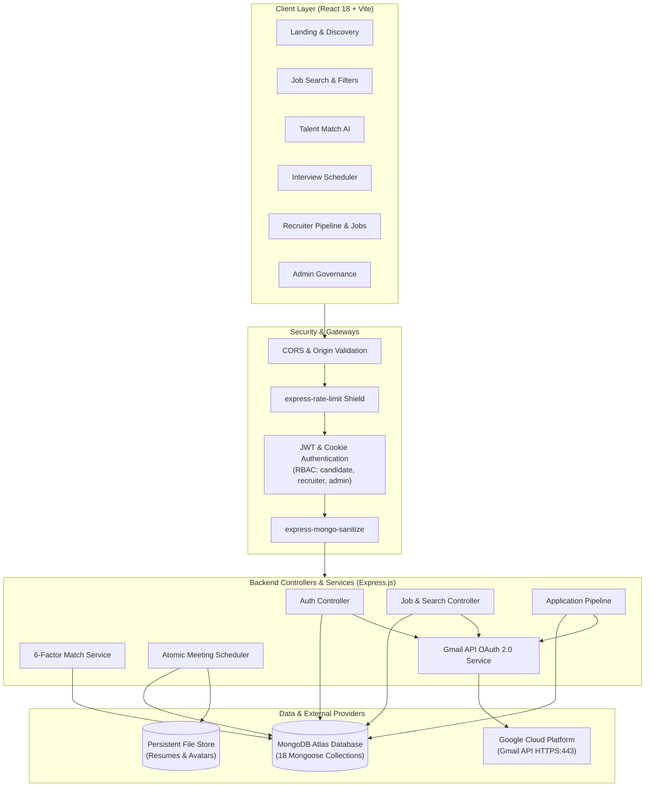

---

## Technology Stack

### Frontend
- **Framework**: React 18 (`react`, `react-dom`, `react-router-dom` v6)
- **Build Engine**: Vite 6 with lightning-fast HMR and optimized asset bundling
- **UI & Styling**: Pure semantic CSS with CSS custom properties (`variables.css`, `layout.css`, `typography.css`, `responsive.css`)
  - Viewport-scaled fluid typography using the custom **Saans** and **Saans Mono** font families
  - Dark-mode ergonomic aesthetic (`#101216` canvas, `#1b1b1b` surfaces, `#8942e4` brand accent)
  - Zero heavy CSS framework dependencies (Strictly **NO Tailwind CSS**)
- **Icons**: Lucide React
- **HTTP Client**: Axios with Bearer token injection, request correlation IDs (`X-Request-ID`), and automatic 401 token refresh queue

### Backend
- **Runtime**: Node.js 18+ LTS
- **Framework**: Express.js 4.19
- **Database Driver**: Mongoose ODM 8
- **Authentication**: JSON Web Tokens (`jsonwebtoken`), bcrypt password hashing (12 salt rounds), Google OAuth 2.0
- **Email Delivery**: Official Google Gmail REST API via `googleapis` and OAuth 2.0 (HTTPS port 443)
- **Security Middleware**: Helmet, CORS, express-mongo-sanitize, express-rate-limit, cookie-parser
- **File Uploads**: Multer with magic-byte file signature validation and path traversal sanitization

### Database & Cloud
- **Database**: MongoDB Atlas M0+ Managed Cloud Cluster
- **Client Hosting**: Vercel Edge Network
- **Server Hosting**: Render Cloud Application Services

---

## Core Feature Highlights

### 1. Candidate Experience
- **Interactive Job Search**: Multi-criteria keyword, location, job type (`Full-time`, `Contract`, `Internship`), experience level, and salary filtering.
- **1-Click Application Workflow**: Submit cover letters, portfolio URLs, and attach verified PDF/DOCX resumes.
- **Application History Tracker**: Real-time status visibility (`applied` $\rightarrow$ `screening` $\rightarrow$ `interviewing` $\rightarrow$ `offered` $\rightarrow$ `hired` or `rejected`).
- **Saved Job Bookmarks**: Pin prospective positions with instant notifications when application deadlines approach.
- **Candidate Profile & Resume Vault**: Manage personal bio, education history, work experience, desired compensation, and view/download stored resume assets.

### 2. Recruiter Experience
- **Job Lifecycle Management**: Draft, publish, edit, pause, and close job postings with instant multi-channel synchronization.
- **Applicant Review Pipeline**: Review candidate profiles, download applicant resumes, post private hiring team notes, and advance applicants through recruitment stages.
- **Company Branding & Profile**: Edit company information, upload corporate logos, and invite team members.
- **Corporate Verification Badge**: Submit legal business credentials for administrative verification to display a verified employer badge.
- **Recruitment Analytics**: Track conversion funnels, applicant velocity, time-to-hire metrics, and export data as CSV reports.

### 3. Talent Match AI (6-Factor Heuristic Matching)
Computes real-time compatibility scores (0–100%) between candidates and open requisitions:
1. **Required Skills Overlap (40%)**: Compares candidate's declared skill set against job requirements.
2. **Experience Level Alignment (20%)**: Compares years of experience against seniority requirements.
3. **Salary Expectation Match (15%)**: Evaluates candidate salary expectations against the job budget.
4. **Location & Remote Preference (10%)**: Analyzes proximity and remote work flexibility.
5. **Education Level (10%)**: Assesses degree level against hiring requirements.
6. **Profile Completeness Bonus (5%)**: Incentivizes thorough profiles.

### 4. Real-Time Interview Scheduler
- **Recruiter Availability Manager**: Configure weekly recurring working hours, buffer intervals (e.g., 15 minutes), meeting duration, and blackout exceptions.
- **Candidate Slot Discovery**: Dynamically queries open slots and eliminates past dates, outside-hours windows, and existing bookings.
- **Atomic Concurrency Protection**: MongoDB atomic reservation queries prevent simultaneous double-booking of the same interview slot.
- **Automated Video Conferencing**: Automatically generates a unique, secure Jitsi video room URL (`https://meet.jit.si/HireConnect-HC-MTG-...`) for every confirmed meeting.

### 5. Dual-Recipient Email Notification System
Built on Google's official Gmail API via OAuth 2.0 over HTTPS port 443:
- **No SMTP Port Blocks**: Eliminates timeouts caused by cloud host SMTP port restrictions.
- **Send-Only Least Privilege**: Uses the minimal OAuth scope (`https://www.googleapis.com/auth/gmail.send`).
- **Dual Notification Flow**: When critical events occur (candidate registration, recruiter registration, job publication, application submission, interview booking, status update), emails are dispatched to:
  1. The **active user** at their MongoDB registered email address.
  2. The **platform administrator** (`sabari1082005@gmail.com`) for oversight.

### 6. Platform Administration & Governance
- **Global Overview Dashboard**: Platform metrics for total users, active jobs, applications, and verification queues.
- **User Governance**: Search users, toggle account statuses (`active`, `suspended`, `banned`), or modify authorization roles.
- **Company Verification Queue**: Review corporate registration certificates and grant verified badges.
- **Job Moderation**: Suppress fraudulent postings or force-close expired listings.
- **Security Audit Logs**: Track platform activities with immutable IP, timestamp, actor, and target records.

---

## Application Screenshots Gallery

All original application captures are stored in the `screenshots/` directory, organized by category:

### User & Platform Pages
| Homepage & Hero Experience | About Us & Platform Mission |
| :---: | :---: |
| 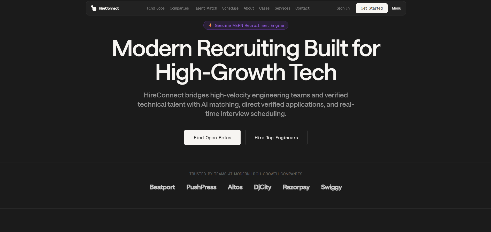 | 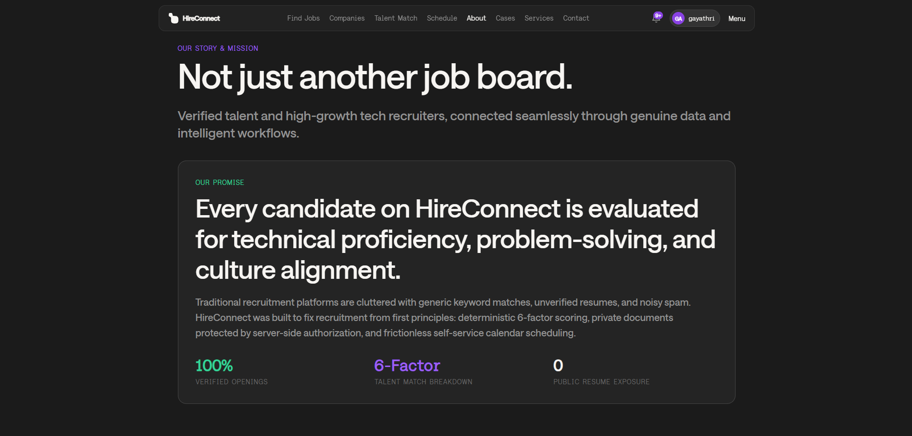 |

| Case Studies & Customer Stories | Enterprise Recruitment Services |
| :---: | :---: |
| 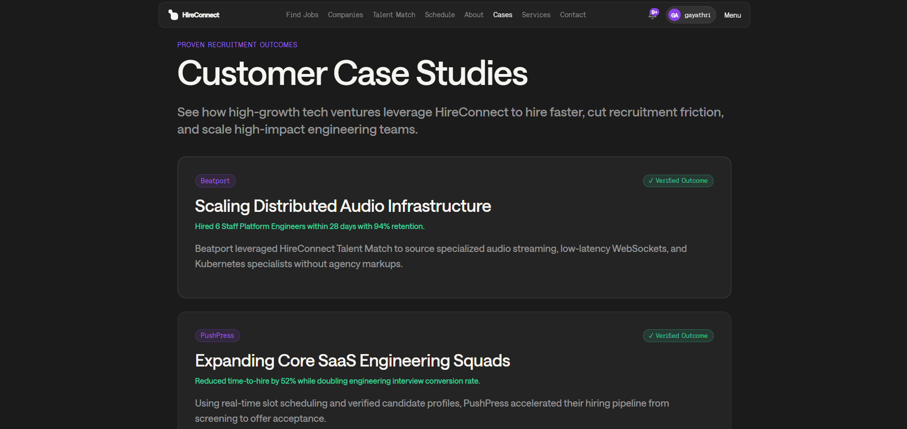 | 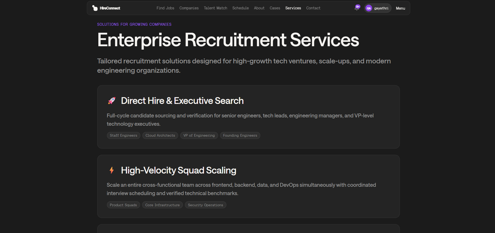 |

| Contact & Inquiries |
| :---: |
| 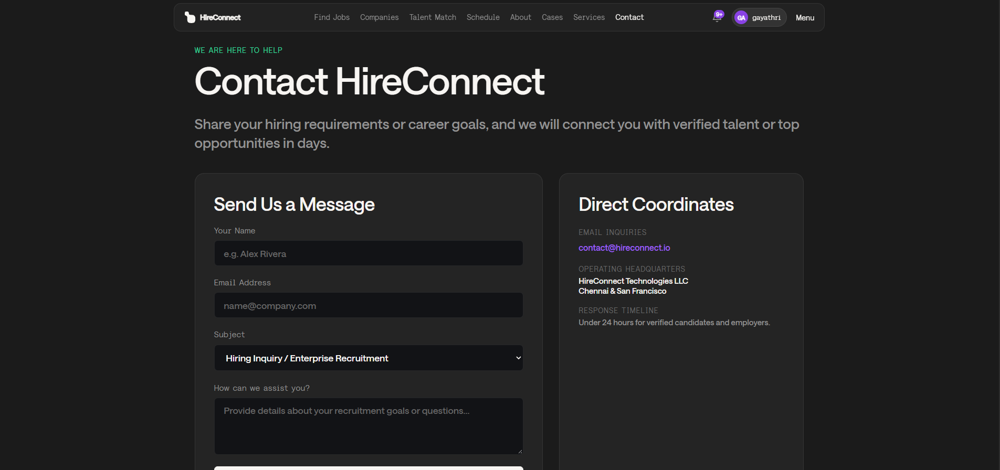 |

### Job Discovery & Candidate Features
| Find Jobs with Multi-Facet Filters | Explore Verified Companies |
| :---: | :---: |
| 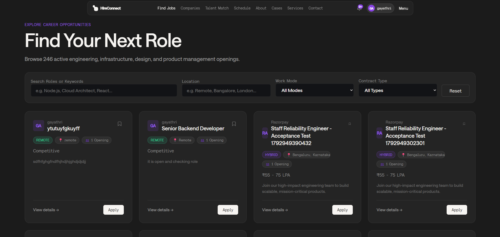 | 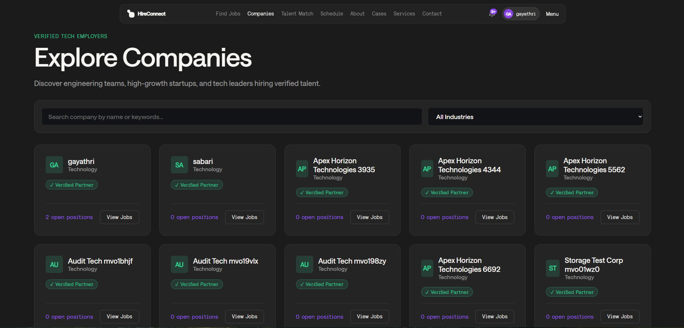 |

| Talent Match AI (6-Factor Fit Scoring) | Interview Scheduling & Video Rooms |
| :---: | :---: |
| 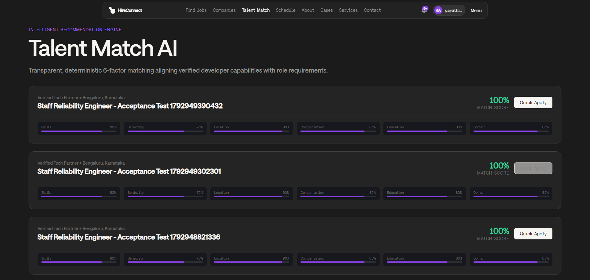 | 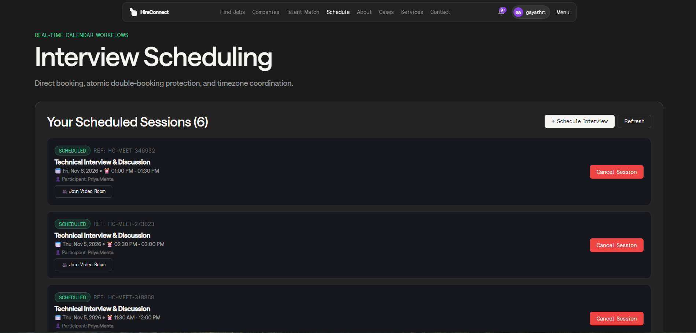 |

### Recruiter & Management Workspaces
| Recruiter Job Postings & Lifecycle | Applicant Review Pipeline & Status Transitions |
| :---: | :---: |
| 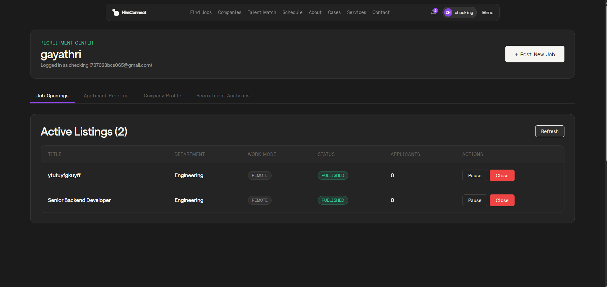 | 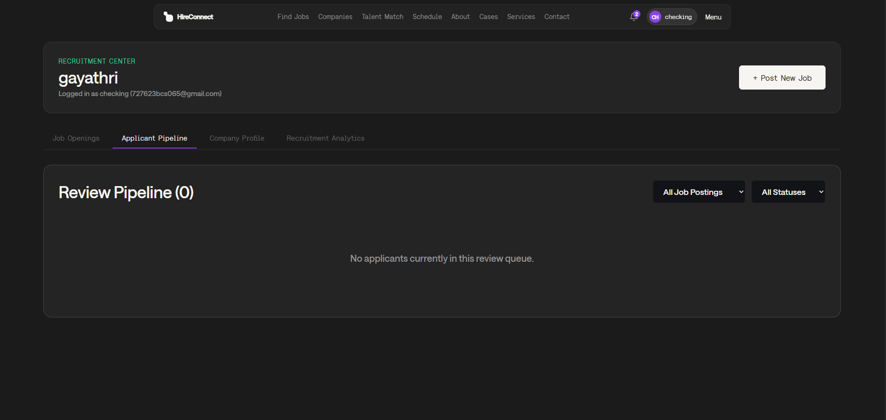 |

| Recruiter Company Profile Management | Recruitment Analytics & Funnel Export |
| :---: | :---: |
| 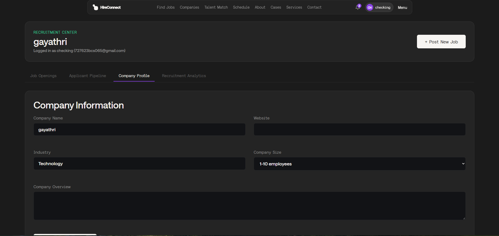 | 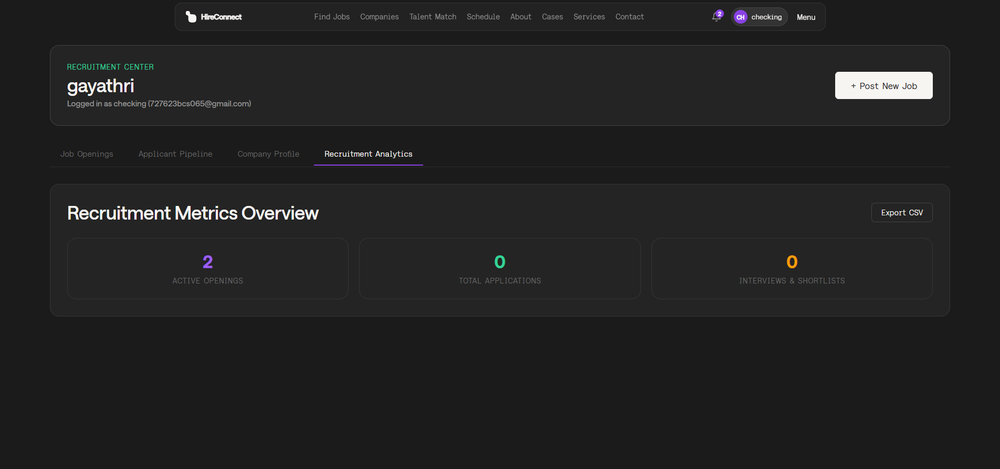 |

---

## Repository Directory Layout

```
HireConnect/
├── .env.example                                  # Root environment template
├── .gitignore                                     # Git ignore definitions
├── package.json                                   # Monorepo root scripts
├── HireConnect FINAL REVIEW.pptx                  # Academic review presentation deck
├── HireConnect_Technical_Project_Report.docx      # Technical project documentation report
├── README.md                                      # Project master documentation
│
├── docs/                                          # Technical specifications
│   ├── README.md                                  # Documentation hub index
│   ├── DATABASE_DESIGN.md                         # 18 Mongoose models & ER diagram
│   └── API_DOCUMENTATION.md                       # Complete 60+ RESTful endpoint specs
│
├── screenshots/                                   # Application screenshots gallery
│   ├── user/                                      # Public user interface captures
│   ├── jobs/                                      # Job discovery & matching captures
│   └── recruiter/                                 # Recruiter workspace & analytics captures
│
├── backend/                                       # Express.js REST API server
│   ├── .env.example                               # Backend environment secrets template
│   ├── package.json                               # Backend dependencies & scripts
│   ├── src/
│   │   ├── app.js                                 # Express application & middleware chain
│   │   ├── server.js                              # Server entry point & graceful shutdown
│   │   ├── config/                                # Database & environment validation
│   │   ├── controllers/                           # 14 REST API controllers
│   │   ├── middleware/                            # Auth, RBAC, rate-limiting, uploads
│   │   ├── models/                                # 18 Mongoose data models
│   │   ├── routes/                                # Modular Express routers
│   │   ├── services/                              # Gmail API, Matching, Scheduling services
│   │   ├── templates/                             # Responsive HTML email templates
│   │   └── utils/                                 # ApiError, ApiResponse, Logger
│   └── tests/                                     # Unit & integration test suites
│
└── frontend/                                      # React 18 + Vite client application
    ├── index.html                                 # HTML5 entry with Saans font preloading
    ├── package.json                               # Frontend dependencies
    ├── vite.config.js                             # Vite configuration with API proxy
    ├── public/                                    # Static assets, fonts, vector logos
    └── src/
        ├── App.jsx                                # Client routing & view orchestration
        ├── main.jsx                               # DOM root hydration
        ├── components/                            # Reusable UI component library
        ├── context/                               # Auth, Notification, Toast contexts
        ├── pages/                                 # Page views (Candidate, Recruiter, Admin)
        ├── services/                              # Axios API client & endpoints
        └── styles/                                # Modular pure CSS design system
```

---

## Database Architecture Overview

HireConnect is powered by **18 MongoDB collections** managed through Mongoose schemas:

| # | Collection / Model | Purpose | Key Indexes |
| :--- | :--- | :--- | :--- |
| 1 | `User` | User identities, hashed passwords, roles (`candidate`, `recruiter`, `admin`) | `{ email: 1 }` (unique) |
| 2 | `CandidateProfile` | Bio, skills, experience, education, salary expectations | `{ user: 1 }` (unique), `{ skills: 1 }` |
| 3 | `RecruiterProfile` | Recruiter metadata, department, hiring disciplines | `{ user: 1 }` (unique), `{ company: 1 }` |
| 4 | `Company` | Corporate entities, verification status, branding assets | `{ slug: 1 }` (unique), `{ name: "text" }` |
| 5 | `CompanyMembership`| Multi-tenant organization roles (`owner`, `admin`, `recruiter`) | `{ company: 1, user: 1 }` (unique) |
| 6 | `CompanyInvitation`| Secure pending email invitations to join companies | `{ token: 1 }` (unique), `{ expiresAt: 1 }` |
| 7 | `CompanyVerificationRequest` | Formal business registration documentation | `{ company: 1 }`, `{ status: 1 }` |
| 8 | `CompanyAuditLog` | Audit trail of organization membership & profile changes | `{ company: 1, createdAt: -1 }` |
| 9 | `Job` | Requisitions, qualifications, salary ranges, lifecycle status | `{ slug: 1 }` (unique), `{ status: 1 }` |
| 10 | `SavedJob` | Candidate bookmark collection | `{ candidate: 1, job: 1 }` (unique) |
| 11 | `Application` | Candidate applications, candidate snapshots, review stages | `{ job: 1, candidate: 1 }` (unique) |
| 12 | `Meeting` | Scheduled interviews, video room links, statuses | `{ reference: 1 }` (unique), `{ recruiter: 1, startTime: 1 }` |
| 13 | `RecruiterAvailability` | Weekly recurring availability windows & meeting rules | `{ recruiter: 1 }` (unique) |
| 14 | `AvailabilityException` | Date overrides, vacation days, custom hours | `{ recruiter: 1, date: 1 }` |
| 15 | `Notification` | In-app alerts, read status, navigation hyperlinks | `{ recipient: 1, isRead: 1, createdAt: -1 }` |
| 16 | `NotificationOutbox` | Reliable queue for asynchronous email delivery | `{ status: 1, attempts: 1 }` |
| 17 | `ResumeAsset` | Stored resume metadata, MIME types, file sizes | `{ user: 1 }` |
| 18 | `AdminAuditLog` | Immutable governance and moderation actions | `{ createdAt: -1 }`, `{ actor: 1 }` |

*For complete schema definitions, validation rules, and the Mermaid ER diagram, refer to [docs/DATABASE_DESIGN.md](./docs/DATABASE_DESIGN.md).*

---

## Environment Variables Configuration

### Backend Environment (`backend/.env`)
Create `backend/.env` based on `backend/.env.example`:

```env
# Server Configuration
PORT=5000
NODE_ENV=development
API_PREFIX=/api
CLIENT_ORIGIN=http://localhost:5173

# Database Connection
MONGODB_URI=mongodb+srv://<username>:<password>@cluster0.mongodb.net/hireconnect?retryWrites=true&w=majority

# JWT Authentication Secrets
JWT_SECRET=your_super_secret_jwt_access_key_min_32_chars
JWT_REFRESH_SECRET=your_super_secret_jwt_refresh_key_min_32_chars
JWT_EXPIRES_IN=15m
JWT_REFRESH_EXPIRES_IN=7d

# Google Cloud OAuth 2.0 (Gmail API Delivery Engine)
GMAIL_CLIENT_ID=your_google_cloud_client_id.apps.googleusercontent.com
GMAIL_CLIENT_SECRET=your_google_cloud_client_secret
GMAIL_REFRESH_TOKEN=your_oauth2_refresh_token_with_gmail_send_scope
GMAIL_USER=sabari1082005@gmail.com
ADMIN_EMAIL=sabari1082005@gmail.com

# Local File Storage Directory
UPLOAD_DIR=uploads
MAX_FILE_SIZE_MB=5
```

### Frontend Environment (`frontend/.env`)
Create `frontend/.env` based on `frontend/.env.example`:

```env
# Backend API Base URL
VITE_API_BASE_URL=http://localhost:5000/api
```

---

## Installation & Running Instructions

### Prerequisites
- **Node.js**: v18.0.0 or higher
- **npm**: v9.0.0 or higher
- **MongoDB**: Local MongoDB instance or free MongoDB Atlas URI

### 1. Clone the Repository
```bash
git clone https://github.com/Sabari1026/MERN-STACK.git
cd MERN-STACK
```

### 2. Backend Setup
```bash
# Navigate to backend directory
cd backend

# Install dependencies
npm install

# Configure environment variables
cp .env.example .env
# Edit .env with your MongoDB URI and Gmail API credentials

# Seed initial admin user (optional)
node src/scripts/bootstrapAdmin.js

# Start backend development server
npm run dev
# Server listening on http://localhost:5000
```

### 3. Frontend Setup
```bash
# In a new terminal window, navigate to frontend directory
cd frontend

# Install dependencies
npm install

# Start Vite frontend development server
npm run dev
# Application running at http://localhost:5173
```

### 4. Full-Stack Single-Command Execution
From the root directory, install all dependencies and run both servers concurrently:
```bash
# Install root orchestration tools
npm install

# Run backend and frontend concurrently
npm run dev
```

---

## Automated Verification & Testing

The repository includes comprehensive backend and frontend test suites verifying API contracts, authentication flows, and security policies:

```bash
# Run backend Vitest unit & integration tests
npm --prefix backend run test

# Run backend test coverage report
npm --prefix backend run test:coverage

# Run frontend build verification
npm --prefix frontend run build
```

---

## Future Enhancements

1. **AI Resume Parser**: Automated extraction of candidate skills, work history, and education from uploaded PDF/DOCX resumes.
2. **WebRTC In-App Video Calls**: Direct peer-to-peer embedded video calling within the HireConnect dashboard.
3. **SMS Multi-Factor Authentication (MFA)**: Enhanced recruiter and administrator account security via Twilio SMS verification.
4. **Automated Salary Benchmarking**: Real-time compensation market percentiles computed using aggregate hiring data.

---

## Academic Reviewers & Acknowledgments

- **Evaluation Panel**: MERN Stack Project Review Committee (November 6, 10 & 11, 2026)
- **Institution**: Department of Computer Science & Engineering
- **Project Contributors**: Sabari Kumar & Team
- **License**: MIT Open Source License

---
*Prepared and submitted for the MERN Stack Final Academic Evaluation — November 2026.*
