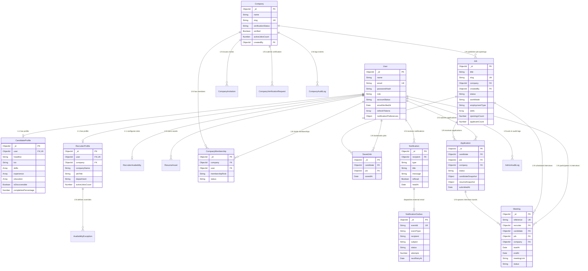

# HireConnect — Database Architecture & Schema Design
### Official MongoDB Technical Specification & Data Dictionary

---

## 1. Executive Summary & Database Architecture

**HireConnect** utilizes a high-availability, document-oriented database architecture built upon **MongoDB Atlas** and modeled through **Mongoose v8 (Object Data Modeling)**. 

### Architectural Highlights
- **Document Model**: Leverages rich, flexible BSON schemas to store hierarchical recruitment data (such as candidate work history, education arrays, screening answers, and interview availability intervals) alongside embedded snapshots to prevent historical data corruption.
- **Data Integrity & Consistency**: Enforces strict Mongoose runtime schema validation, Zod request body validation, unique compound indexes, and custom pre-save validation hooks.
- **Historical Snapshotting**: Implements immutable snapshot patterns within the `Application` collection (`candidateSnapshot`, `resumeSnapshot`) to ensure historical records remain intact even if candidate profiles or resume files are subsequently modified or deleted.
- **Concurrency & Double-Booking Protection**: Uses compound unique indexes (e.g., `[job, candidate]` unique index on applications, `[company, user]` unique index on memberships, and overlapping time range validations on meetings) to guarantee atomic operations and prevent race conditions.
- **Security & Authorization Controls**: Enforces encrypted password hashes via Bcrypt (12 rounds), one-way SHA-256 token hashing for password reset and email verification tokens, and session token rotation.

---

## 2. Entity-Relationship Diagram (Mermaid ERD)

---

## 3. Data Dictionary & Detailed Schema Specifications

HireConnect incorporates **18 distinct Mongoose models and MongoDB collections**:

---

### 3.1. `users` (User Model)
* **Primary Key**: `_id` (`ObjectId`)
* **Collection**: `users`
* **Purpose**: Primary identity and authentication document storing user credentials, role-based authorization gates, session tokens, and communication preferences.

| Field | Data Type | Required | Default | Validation & Constraints | Description |
| :--- | :--- | :--- | :--- | :--- | :--- |
| `name` | `String` | Yes | — | Min 2, Max 100 chars, trimmed | Full name of the user |
| `email` | `String` | Yes | — | Valid email format, lowercase, unique | Authenticated email identifier |
| `passwordHash` | `String` | Yes* | — | Minimum 60 chars (Bcrypt hash) | 12-round salted password hash |
| `role` | `String` | Yes | `'candidate'` | Enum: `['candidate', 'recruiter', 'admin', 'employee']` | Core platform role for RBAC authorization |
| `avatarUrl` | `String` | No | `null` | Valid URI or relative storage path | Profile picture asset URL |
| `authProviders` | `Array` | No | `[]` | Sub-documents: `provider`, `providerId` | External federated OAuth IDs (Google) |
| `emailVerifiedAt` | `Date` | No | `null` | — | Timestamp of email verification |
| `accountStatus` | `String` | Yes | `'active'` | Enum: `['active', 'suspended', 'pending_verification']` | Account governance status |
| `lastLoginAt` | `Date` | No | `null` | — | Timestamp of most recent authentication |
| `passwordChangedAt` | `Date` | No | `null` | — | Revokes tokens issued prior to this date |
| `passwordResetTokenHash` | `String` | No | `null` | SHA-256 hash | One-time password recovery token hash |
| `passwordResetExpiresAt` | `Date` | No | `null` | — | Expiration timestamp for reset token |
| `refreshTokens` | `Array` | No | `[]` | Sub-documents: `tokenHash`, `expiresAt`, `deviceId`, `createdAt` | Active multi-device refresh token sessions |
| `notificationPreferences` | `Object` | No | Embedded | Preferences for `email` categories and `inApp` | Channel toggles (e.g. `jobUpdates`, `newApplicant`) |

#### Indexes:
- `{ email: 1 }` — **Unique index** preventing duplicate user registrations.
- `{ role: 1, accountStatus: 1 }` — Compound index accelerating administrative role filtering.
- `{ 'authProviders.provider': 1, 'authProviders.providerId': 1 }` — Sparse compound index for OAuth lookups.

---

### 3.2. `candidateprofiles` (CandidateProfile Model)
* **Primary Key**: `_id` (`ObjectId`)
* **Collection**: `candidateprofiles`
* **Purpose**: Rich technical portfolio, employment history, education, discoverability, and preferences for candidates.

| Field | Data Type | Required | Default | Validation & Constraints | Description |
| :--- | :--- | :--- | :--- | :--- | :--- |
| `user` | `ObjectId` | Yes | — | Ref: `User`, Unique | Foreign key linking to parent User document |
| `headline` | `String` | No | `''` | Max 150 chars, trimmed | Professional title (e.g. "Senior React Engineer") |
| `summary` | `String` | No | `''` | Max 5000 chars, trimmed | Professional narrative summary |
| `bio` | `String` | No | `''` | Max 5000 chars | Alias for summary persistence |
| `phone` | `String` | No | `''` | E.164 phone format | Contact telephone number |
| `contactEmail` | `String` | No | `''` | Valid email | Optional secondary contact email |
| `location` | `String` | No | `''` | City, State, Country | Current residential location |
| `preferredLocations` | `[String]` | No | `[]` | — | Target locations for job searches |
| `preferredWorkModes` | `[String]` | No | `['remote']` | Enum: `['remote', 'hybrid', 'onsite']` | Preferred working models |
| `skills` | `[String]` | No | `[]` | Normalized lowercase/trimmed | Verified technical competencies |
| `experience` | `[Object]` | No | `[]` | `title`, `company`, `startDate`, `endDate`, `current`, `description` | Chronological employment records |
| `education` | `[Object]` | No | `[]` | `institution`, `degree`, `fieldOfStudy`, `startDate`, `endDate` | Academic history records |
| `projects` | `[Object]` | No | `[]` | `title`, `description`, `url`, `technologies` | Technical project highlights |
| `resume` | `ObjectId` | No | `null` | Ref: `ResumeAsset` | Reference to active verified resume file |
| `isDiscoverable` | `Boolean` | No | `true` | — | Controls visibility in recruiter talent searches |
| `hideContactInfo` | `Boolean` | No | `false` | — | Redacts phone and email from public view |
| `completionPercentage` | `Number` | No | `0` | Range: `0 - 100` | Profile completeness calculation |

#### Indexes:
- `{ user: 1 }` — **Unique index** enforcing strict 1:1 user-to-profile relationship.

---

### 3.3. `recruiterprofiles` (RecruiterProfile Model)
* **Primary Key**: `_id` (`ObjectId`)
* **Collection**: `recruiterprofiles`
* **Purpose**: Organizational affiliation, department metadata, and hiring authority data for corporate recruiters.

| Field | Data Type | Required | Default | Validation & Constraints | Description |
| :--- | :--- | :--- | :--- | :--- | :--- |
| `user` | `ObjectId` | Yes | — | Ref: `User`, Unique | Foreign key linking to parent User document |
| `company` | `ObjectId` | No | `null` | Ref: `Company` | Primary organization employer |
| `companyName` | `String` | No | `''` | Max 150 chars | Denormalized company name for fast retrieval |
| `jobTitle` | `String` | No | `'Talent Acquisition Partner'` | Max 100 chars | Recruiter corporate job title |
| `department` | `String` | No | `'Human Resources'` | Max 100 chars | Operating department |
| `phone` | `String` | No | `''` | Valid phone format | Recruiter direct telephone line |
| `location` | `String` | No | `''` | City / Region | Recruiter operating location |
| `linkedinUrl` | `String` | No | `''` | Valid HTTP/HTTPS URI | Professional LinkedIn URL |
| `activeJobsCount` | `Number` | No | `0` | Min: 0 | Number of open jobs managed |

#### Indexes:
- `{ user: 1 }` — **Unique index** enforcing 1:1 user-to-recruiter relationship.

---

### 3.4. `companies` (Company Model)
* **Primary Key**: `_id` (`ObjectId`)
* **Collection**: `companies`
* **Purpose**: Verified employer organizations publishing jobs and reviewing talent pipelines.

| Field | Data Type | Required | Default | Validation & Constraints | Description |
| :--- | :--- | :--- | :--- | :--- | :--- |
| `name` | `String` | Yes | — | Min 2, Max 150 chars, trimmed | Registered corporate name |
| `normalizedName` | `String` | Yes | — | Lowercase trimmed | De-duplicated search key |
| `slug` | `String` | Yes | — | URL-safe slug, unique | URL route slug identifier (e.g. `razorpay`) |
| `website` | `String` | No | `''` | Valid URL | Official corporate web domain |
| `industry` | `String` | Yes | `'Technology'` | Max 100 chars | Business sector / classification |
| `companySize` | `String` | No | `'50-200'` | Enum: `['1-10', '11-50', '50-200', '201-500', '500+']` | Workforce size range |
| `verificationStatus` | `String` | Yes | `'pending'` | Enum: `['pending', 'under_review', 'verified', 'rejected', 'suspended']` | Platform authorization gate for job publication |
| `verified` | `Boolean` | Yes | `false` | — | Boolean flag mirror of verificationStatus |
| `activeJobsCount` | `Number` | Yes | `0` | Min: 0 | Cached count of currently published active jobs |
| `techStack` | `[String]` | No | `[]` | — | Technologies utilized across the organization |
| `createdBy` | `ObjectId` | Yes | — | Ref: `User` | Recruiter or administrator who created the record |

#### Indexes:
- `{ slug: 1 }` — **Unique index** for fast vanity URL routing (`/companies/:slug`).
- `{ name: 1 }` & `{ normalizedName: 1 }` — Accelerated company lookups.
- `{ verificationStatus: 1 }` — Used for administrative review queues.
- `{ createdAt: -1 }` — Sorts newest registered companies first.

---

### 3.5. `jobs` (Job Model)
* **Primary Key**: `_id` (`ObjectId`)
* **Collection**: `jobs`
* **Purpose**: Technical job listings published by verified companies with compensation, skills, screening requirements, and lifecycle tracking.

| Field | Data Type | Required | Default | Validation & Constraints | Description |
| :--- | :--- | :--- | :--- | :--- | :--- |
| `title` | `String` | Yes | — | Min 3, Max 200 chars, trimmed | Position title |
| `slug` | `String` | Yes | — | URL-safe unique slug | Vanity URL identifier |
| `company` | `ObjectId` | Yes | — | Ref: `Company` | Publishing corporate entity |
| `companyName` | `String` | Yes | — | — | Denormalized company name |
| `createdBy` | `ObjectId` | Yes | — | Ref: `User` | Recruiter who authored the opening |
| `department` | `String` | No | `'Engineering'` | — | Organizational department |
| `workMode` | `String` | Yes | `'remote'` | Enum: `['remote', 'hybrid', 'onsite']` | Workplace flexibility model |
| `employmentType` | `String` | Yes | `'full-time'` | Enum: `['full-time', 'part-time', 'contract', 'internship']` | Engagement contractual classification |
| `location` | `String` | Yes | `'Remote'` | — | Job location specification |
| `salaryMin` | `Number` | No | `null` | Min: 0 | Annual compensation floor |
| `salaryMax` | `Number` | No | `null` | Min: 0 | Annual compensation ceiling |
| `salaryCurrency` | `String` | Yes | `'USD'` | ISO 3-letter currency code | Currency denominator |
| `skills` | `[String]` | Yes | `[]` | Minimum 1 skill | Core technical requirements |
| `description` | `String` | Yes | — | Min 10, Max 20000 chars | Comprehensive job description |
| `screeningQuestions` | `[Object]` | No | `[]` | `question`, `required` | Mandatory candidate screening questionnaires |
| `status` | `String` | Yes | `'draft'` | Enum: `['draft', 'published', 'paused', 'closed']` | Listing lifecycle state |
| `publishedAt` | `Date` | No | `null` | — | Timestamp of publication |
| `applicantCount` | `Number` | Yes | `0` | Min: 0 | Cached count of candidate submissions |
| `moderationStatus` | `String` | Yes | `'approved'` | Enum: `['pending', 'approved', 'removed', 'flagged']` | Administrative content gate |

#### Indexes:
- `{ slug: 1 }` — **Unique index** for URL resolution.
- `{ title: 'text', description: 'text', companyName: 'text', skills: 'text' }` — **Full-text search index** powering multi-term job search.
- `{ status: 1, publishedAt: -1 }` — Index optimizing public job search feeds.
- `{ company: 1, status: 1 }` — Index filtering jobs by specific company.

---

### 3.6. `applications` (Application Model)
* **Primary Key**: `_id` (`ObjectId`)
* **Collection**: `applications`
* **Purpose**: Records a candidate's formal application to a job listing, tracking multi-stage pipeline status, screening responses, internal recruiter notes, and immutable snapshot data.

| Field | Data Type | Required | Default | Validation & Constraints | Description |
| :--- | :--- | :--- | :--- | :--- | :--- |
| `candidate` | `ObjectId` | Yes | — | Ref: `User` | Applying candidate user document |
| `job` | `ObjectId` | Yes | — | Ref: `Job` | Target job listing |
| `company` | `ObjectId` | Yes | — | Ref: `Company` | Associated company entity |
| `status` | `String` | Yes | `'applied'` | Enum: `['applied', 'under_review', 'shortlisted', 'interview', 'offered', 'rejected', 'withdrawn']` | Recruitment pipeline stage |
| `coverLetter` | `String` | No | `''` | Max 5000 chars | Optional cover letter text |
| `answers` | `[Object]` | No | `[]` | `question`, `answer` | Candidate responses to job screening questions |
| `resumeSnapshot` | `Object` | Yes | Embedded | `assetId`, `fileName`, `fileUrl`, `fileType`, `fileSize`, `storageKey` | Frozen snapshot of resume asset at moment of submission |
| `candidateSnapshot`| `Object` | Yes | Embedded | `name`, `headline`, `location`, `phone`, `email`, `summary` | Frozen snapshot of candidate profile data |
| `statusHistory` | `[Object]` | Yes | `[]` | `fromStatus`, `toStatus`, `changedBy`, `reason`, `changedAt` | Immutable audit trail of status progressions |
| `notes` | `[Object]` | No | `[]` | `author`, `authorName`, `text`, `createdAt` | Private internal recruiter notes |
| `submittedAt` | `Date` | Yes | `Date.now` | — | Initial submission timestamp |

#### Indexes:
- `{ job: 1, candidate: 1 }` — **Compound unique index** strictly preventing duplicate applications to the same job opening.
- `{ company: 1, status: 1 }` — Accelerates recruiter applicant pipeline queries.
- `{ candidate: 1, submittedAt: -1 }` — Accelerates candidate application tracking history queries.

---

### 3.7. `meetings` (Meeting Model)
* **Primary Key**: `_id` (`ObjectId`)
* **Collection**: `meetings`
* **Purpose**: Scheduled interview sessions between recruiters and candidates, managing time slots, video room links, and lifecycle states.

| Field | Data Type | Required | Default | Validation & Constraints | Description |
| :--- | :--- | :--- | :--- | :--- | :--- |
| `reference` | `String` | Yes | Generated | Format: `HC-MEET-XXXXXX`, Unique | Human-readable meeting reference code |
| `recruiter` | `ObjectId` | Yes | — | Ref: `User` | Interviewer host |
| `candidate` | `ObjectId` | Yes | — | Ref: `User` | Candidate interviewee |
| `job` | `ObjectId` | No | `null` | Ref: `Job` | Associated job listing |
| `company` | `ObjectId` | No | `null` | Ref: `Company` | Associated company entity |
| `title` | `String` | Yes | — | Max 200 chars | Interview session title |
| `durationMinutes` | `Number` | Yes | `30` | Enum: `[15, 30, 45, 60]` | Session duration |
| `startAt` | `Date` | Yes | — | ISO DateTime | Scheduled interview start time |
| `endAt` | `Date` | Yes | — | ISO DateTime | Scheduled interview conclusion time |
| `timeZone` | `String` | Yes | `'UTC'` | IANA timezone string | Recruiter operating timezone |
| `status` | `String` | Yes | `'scheduled'` | Enum: `['scheduled', 'rescheduled', 'completed', 'cancelled', 'no_show']` | Interview status |
| `meetingLink` | `String` | Yes | Generated | Valid URL | Secure video conferencing link |
| `cancellationReason`| `String` | No | `''` | Max 500 chars | Reason for session termination |

#### Indexes:
- `{ reference: 1 }` — **Unique index** for meeting reference lookup.
- `{ recruiter: 1, status: 1, startAt: 1, endAt: 1 }` — Fast availability collision detector preventing double bookings.
- `{ candidate: 1, startAt: 1 }` — Candidate interview schedule index.

---

### 3.8. `recruiteravailabilities` (RecruiterAvailability Model)
* **Primary Key**: `_id` (`ObjectId`)
* **Collection**: `recruiteravailabilities`
* **Purpose**: Weekly recurring time window configuration and rules governing self-serve interview booking.

| Field | Data Type | Required | Default | Description |
| :--- | :--- | :--- | :--- | :--- |
| `recruiter` | `ObjectId` | Yes | — | Ref: `User`, **Unique index** enforcing 1:1 availability document |
| `timeZone` | `String` | Yes | `'Asia/Kolkata'` | Operating IANA timezone for weekly rules |
| `weeklyRules` | `[Object]` | Yes | Default rules | Array of `{ dayOfWeek: 0-6, intervals: [{ start: "09:00", end: "17:00" }] }` |
| `slotDurations` | `[Number]` | Yes | `[30, 45, 60]` | Permitted interview duration blocks in minutes |
| `bufferBeforeMinutes`| `Number` | Yes | `10` | Buffer period required prior to meeting start |
| `bufferAfterMinutes` | `Number` | Yes | `10` | Buffer period required following meeting end |
| `minimumNoticeMinutes`| `Number` | Yes | `120` | Minimum lead time before an interview can be booked |
| `maximumBookingDaysAhead`| `Number` | Yes | `14` | Horizon limit for calendar reservations |
| `active` | `Boolean` | Yes | `true` | Master toggle for self-service booking |

---

### 3.9. `notifications` (Notification Model)
* **Primary Key**: `_id` (`ObjectId`)
* **Collection**: `notifications`
* **Purpose**: In-app activity feed and event stream for candidate status transitions, recruiter applications, and interviews.

| Field | Data Type | Required | Default | Description |
| :--- | :--- | :--- | :--- | :--- |
| `recipient` | `ObjectId` | Yes | — | Ref: `User` recipient of the notification |
| `type` | `String` | Yes | — | Enum: `['application_submitted', 'application_status_changed', 'new_applicant', 'interview_scheduled', 'interview_cancelled', 'interview_invitation', 'job_published', 'job_closed', 'welcome']` |
| `title` | `String` | Yes | — | Concise notification headline |
| `message` | `String` | Yes | — | Human-readable notification body |
| `actionUrl` | `String` | No | `''` | Deep-link target route within the frontend |
| `readAt` | `Date` | No | `null` | Timestamp when notification was opened |
| `isDismissed` | `Boolean` | Yes | `false` | Soft-delete / dismissal indicator |
| `deduplicationKey` | `String` | No | `null` | Sparse index key preventing duplicate notifications |

---

### 3.10. `notificationoutboxes` (NotificationOutbox Model)
* **Primary Key**: `_id` (`ObjectId`)
* **Collection**: `notificationoutboxes`
* **Purpose**: Implements the transactional **Outbox Pattern** for reliable email delivery over the **Google Gmail API**.

| Field | Data Type | Required | Default | Description |
| :--- | :--- | :--- | :--- | :--- |
| `eventId` | `String` | Yes | Unique | Deduplication event identifier (e.g. `evt-job_status:job123:published`) |
| `eventType` | `String` | Yes | — | Business event type triggering the email |
| `recipient` | `String` | Yes | — | Verified destination email address |
| `subject` | `String` | Yes | — | Rendered email subject line |
| `htmlContent` | `String` | Yes | — | Fully formatted responsive HTML body |
| `textContent` | `String` | Yes | — | Plain text email fallback |
| `status` | `String` | Yes | `'pending'` | Enum: `['pending', 'processing', 'sent', 'retry_scheduled', 'failed']` |
| `attempts` | `Number` | Yes | `0` | Number of delivery attempts executed |
| `maxAttempts` | `Number` | Yes | `5` | Maximum permissible retries before dead-lettering |
| `nextRetryAt` | `Date` | Yes | `Date.now` | Exponential backoff scheduling timestamp |
| `lastError` | `String` | No | `null` | Sanitized diagnostic error message from delivery provider |

---

### 3.11. `savedjobs` (SavedJob Model)
* **Primary Key**: `_id` (`ObjectId`)
* **Collection**: `savedjobs`
* **Purpose**: Candidate bookmarking and saved job listings.

| Field | Data Type | Required | Default | Description |
| :--- | :--- | :--- | :--- | :--- |
| `candidate` | `ObjectId` | Yes | — | Ref: `User` candidate who bookmarked the job |
| `job` | `ObjectId` | Yes | — | Ref: `Job` listing bookmarked |
| `savedAt` | `Date` | Yes | `Date.now` | Timestamp bookmark was created |

#### Indexes:
- `{ candidate: 1, job: 1 }` — **Compound unique index** preventing duplicate saves of the same job.

---

### 3.12. `resumeassets` (ResumeAsset Model)
* **Primary Key**: `_id` (`ObjectId`)
* **Collection**: `resumeassets`
* **Purpose**: Metadata and integrity tracking for uploaded PDF/DOCX resumes.

| Field | Data Type | Required | Default | Description |
| :--- | :--- | :--- | :--- | :--- |
| `user` | `ObjectId` | Yes | — | Ref: `User` owner of the asset |
| `storageKey` | `String` | Yes | Unique | Cryptographic storage identifier on disk or object store |
| `originalFilename`| `String` | Yes | — | Original file name during upload |
| `mimeType` | `String` | Yes | — | Validated MIME type (`application/pdf`, `application/vnd.openxmlformats...`) |
| `sizeBytes` | `Number` | Yes | — | File size in bytes (max 10MB) |
| `isCurrent` | `Boolean` | Yes | `true` | Active resume pointer for 1-click apply |

---

### 3.13. Additional Supporting Collections
- **`companymemberships`**: Manages organization access control. Fields: `company`, `user`, `membershipRole` (`owner`, `admin`, `recruiter`), `status` (`active`, `invited`, `revoked`). Unique compound index: `{ company: 1, user: 1 }`.
- **`companyinvitations`**: Pending organization email invites. Fields: `company`, `email`, `role`, `tokenHash`, `expiresAt`, `status`.
- **`companyverificationrequests`**: Official company review queue. Fields: `company`, `requestedBy`, `officialEmail`, `website`, `businessRegistrationNumber`, `documents`, `status` (`pending`, `under_review`, `verified`, `rejected`), `reviewerNotes`.
- **`companyauditlogs`**: Immutable organizational security audit log. Fields: `eventType`, `company`, `actorId`, `actorEmail`, `actorRole`, `metadata`, `outcome`.
- **`adminauditlogs`**: Immutable platform administrative action log. Fields: `actor`, `action`, `resourceType`, `resourceId`, `previousState`, `newState`, `reason`, `ipAddress`.
- **`availabilityexceptions`**: Recruiter calendar overrides (vacations, date-specific blockouts). Fields: `recruiter`, `startAt`, `endAt`, `type` (`unavailable`, `custom_hours`), `reason`.

---

## 4. Relationship Models (Cardinality Summary)

| Source Entity | Relationship | Target Entity | Mechanism & Cardinality |
| :--- | :---: | :--- | :--- |
| **`User`** | `1 : 1` | **`CandidateProfile`** | Unique index on `CandidateProfile.user` |
| **`User`** | `1 : 1` | **`RecruiterProfile`** | Unique index on `RecruiterProfile.user` |
| **`User`** | `1 : 1` | **`RecruiterAvailability`**| Unique index on `RecruiterAvailability.recruiter` |
| **`Company`** | `1 : N` | **`Job`** | Foreign key `Job.company` referencing `Company._id` |
| **`Company`** | `M : N` | **`User`** | Junction collection `CompanyMembership` (`company` + `user`) |
| **`Job`** | `1 : N` | **`Application`** | Foreign key `Application.job` referencing `Job._id` |
| **`User`** (Candidate) | `1 : N` | **`Application`** | Foreign key `Application.candidate` referencing `User._id` |
| **`Application`** | `1 : N` | **`Meeting`** | Foreign key `Meeting.application` referencing `Application._id` |
| **`Candidate`** | `M : N` | **`Job`** (Saved) | Junction collection `SavedJob` with compound unique index |
| **`User`** | `1 : N` | **`Notification`** | Foreign key `Notification.recipient` referencing `User._id` |

---

## 5. Academic Review Conclusion

The HireConnect database architecture is designed specifically to solve common vulnerabilities in traditional recruitment platforms:
1. **Zero Data Corruption on Profile Edits**: Applications snapshot candidate resumes and profile data at the moment of application.
2. **Double-Booking Prevention**: Mathematical slot interval checking and compound indexes on meeting start times prevent concurrent recruiter collision.
3. **Data Privacy**: Private candidate resumes are strictly gated by membership authorization and are never exposed via unauthenticated public endpoints.
