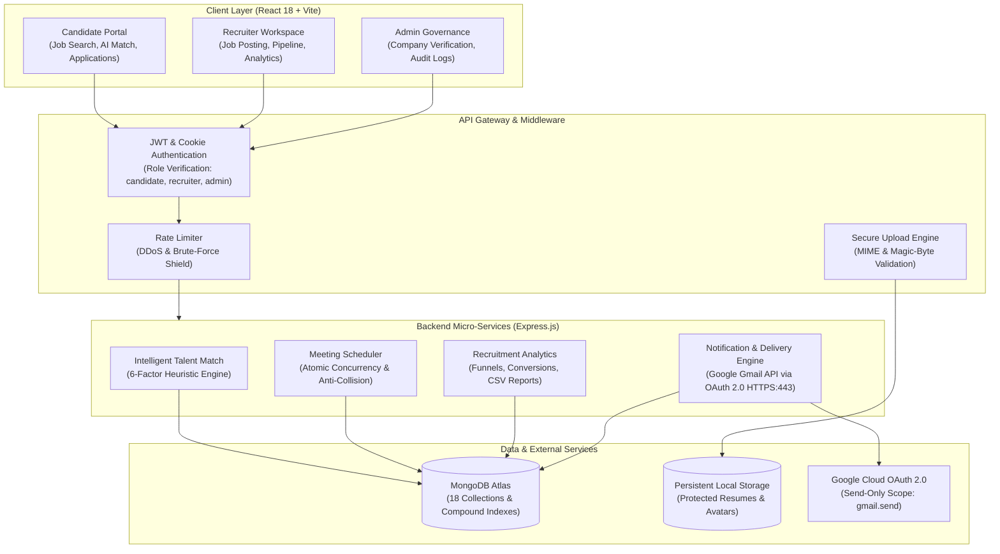

# HireConnect Documentation Hub

Welcome to the **HireConnect Platform Documentation Hub**. This central directory contains comprehensive technical specifications, database architectures, REST API contracts, and academic presentation assets prepared for the **MERN Stack Final Project Review (November 6, 10 & 11, 2026)**.

---

## Quick Navigation

| Document / Asset | Description | Direct Link |
| :--- | :--- | :--- |
| **System README** | Main platform guide, feature catalog, setup, and live links | [Root README.md](../README.md) |
| **Database Design** | 18 MongoDB collections, Mongoose schemas, compound indexes, and Mermaid ER diagram | [DATABASE_DESIGN.md](./DATABASE_DESIGN.md) |
| **API Documentation** | RESTful endpoint specifications, HTTP methods, auth gates, JSON payloads, and error codes | [API_DOCUMENTATION.md](./API_DOCUMENTATION.md) |
| **Final Review Presentation** | Official PowerPoint slide deck for evaluation | [HireConnect FINAL REVIEW.pptx](../HireConnect%20FINAL%20REVIEW.pptx) |
| **Technical Project Report** | Formal Word document report detailing methodology, architecture, and results | [HireConnect_Technical_Project_Report.docx](../HireConnect_Technical_Project_Report.docx) |
| **Screenshots Gallery** | 13 high-resolution production application captures organized by role | [Screenshots Directory](../screenshots/) |

---

## System Overview & Architecture

HireConnect is an enterprise-grade recruitment ecosystem connecting job seekers, corporate recruiters, and platform administrators. Built on the modern MERN stack (MongoDB Atlas, Express.js, React 18, Node.js), it replaces fragmented hiring processes with an end-to-end talent pipeline.

---

## Core System Highlights

### 1. Dual-Notification Email Architecture (Gmail API OAuth 2.0)
- Communicates directly over secure HTTPS port 443 via Google's official REST API, bypassing restrictive cloud hosting SMTP port blocks (such as Render's outbound port 465/587 blocks).
- Dispatches distinct, branded transactional emails to both the active user (candidate/recruiter) at their MongoDB registered email address and the platform admin (`sabari1082005@gmail.com`).
- Send-only OAuth scope (`https://www.googleapis.com/auth/gmail.send`) ensures zero access to private mailbox contents.

### 2. 6-Factor Talent Matching Engine
- Multi-dimensional compatibility scoring computing real-time candidate-job fit:
  - Required Skills Overlap (40%)
  - Experience Level & Seniority (20%)
  - Compensation Expectation Alignment (15%)
  - Location & Remote Preference (10%)
  - Education & Degree Alignment (10%)
  - Profile Completeness Bonus (5%)

### 3. Concurrency-Controlled Interview Scheduler
- Recruiter weekly recurring availability with granular date exceptions (vacations/holidays).
- Atomic reservation checks guaranteeing zero double-booking under concurrent candidate booking attempts.
- Automated calendar invitation generation with secure Jitsi video room URLs (`https://meet.jit.si/HireConnect-...`).

### 4. Enterprise Company Governance & Verification
- Corporate recruitment onboarding with multi-tenant company memberships (`owner`, `admin`, `recruiter`).
- Official company verification request workflow requiring legal business registration proof.
- Verified company badge displayed across all active job postings.

---

## Documentation Index

### [Database Design Specification](./DATABASE_DESIGN.md)
Detailed documentation of the MongoDB data model:
- 18 Mongoose schemas with data types, defaults, validation rules, and indexes.
- Entity-Relationship (ER) diagram illustrating foreign key references (`User`, `CandidateProfile`, `RecruiterProfile`, `Company`, `Job`, `Application`, `Meeting`, etc.).
- Snapshotting patterns preserving application state upon job edits.
- Data integrity, cascade deletion, and audit logging policies.

### [API Documentation Specification](./API_DOCUMENTATION.md)
Complete technical reference of all 60+ REST endpoints:
- Standard response and error payload envelopes.
- Authentication requirements (Public, Candidate, Recruiter, Admin).
- JSON request and response examples for every operation.
- Query parameters, pagination contracts, and HTTP status codes.

---

## Production Deployment Coordinates

- **Frontend Client**: [https://mern-stack-9192.vercel.app](https://mern-stack-9192.vercel.app)
  - Hosted on Vercel with automatic CI/CD deployment.
  - Preloaded Saans typography and responsive rem-scaling.
- **Backend API**: [https://hireconnect-backend-tdb0.onrender.com](https://hireconnect-backend-tdb0.onrender.com)
  - Hosted on Render with Node.js 18+ runtime.
  - Active probes: `/api/health`, `/api/health/live`, `/api/health/email`.

---
*Created for the HireConnect Academic Project Evaluation — November 2026.*
